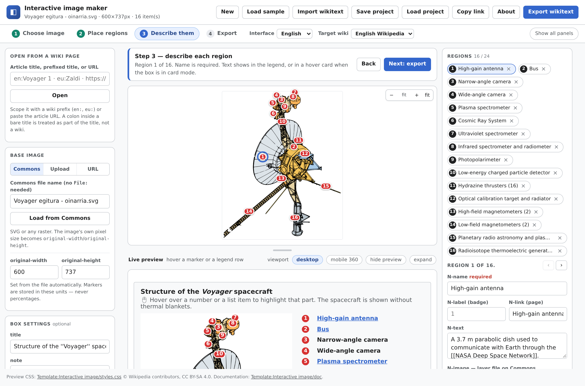

# Interactive image maker

A point-and-click editor for the `{{Interactive image}}` template on Wikipedia — the one that lets a
reader hover a numbered diagram and see each part highlighted, explained, or swapped for a detail
drawing.



**Try it:** <https://interactive-image-maker.toolforge.org> — running on Wikimedia Toolforge, built
from this repository. (To run your own copy, see [Deploying](#deploying).)

---

## First, what is an interactive image?

A normal Wikipedia image is fixed: a picture with a caption, and that is all. If the picture is a
diagram of a spacecraft, a skeleton, or a map, a reader cannot point at a part and ask "what is
that?" — the answer has to be written out in prose next to it.

`{{Interactive image}}` changes that. You give the template a base picture plus a numbered marker
for each region, and for each region a **second picture showing only that part**. A reader who
hovers marker 4 — or row 4 in the legend — sees that part appear on top of the base image. Nothing
is clicked, no JavaScript runs, and it works for logged-out readers on any skin.

On English Wikipedia it looks like this in wikitext:

```wikitext
{{Interactive image
|image = Voyager egitura - oinarria.svg
|original-width  = 600
|original-height = 737
|1-name  = High-gain antenna
|1-text  = A 3.7 m parabolic dish used to communicate with Earth.
|1-image = Voyager egitura - antena.svg
|1-x = 215 |1-y = 338
}}
```

Real examples: [Voyager 1](https://en.wikipedia.org/wiki/Voyager_1) (16 spacecraft parts),
[Zaldi](https://eu.wikipedia.org/wiki/Zaldi#Eskeletoa) (horse and human skeleton compared).

Two things trip people up, and both are why this tool exists:

- **Coordinates are in the base image's own pixel units**, not percentages. Get the units wrong and
  every marker sits plausibly but wrongly — which looks like a CSS bug, not a number you mistyped.
- **Every layer must be the same canvas as the base** — same `viewBox`, same proportions. A layer
  cut from a differently-sized drawing appears shifted and scaled when hovered.

There is no coordinate picker on the wikis and the template's documentation is a parameter table.
So: this tool.

## Background

The template and this tool are recent. `{{Interactive image}}` **debuted in Q4 2026**: it was
initiated by **Galder Gonzalez** ([User:Theklan](https://en.wikipedia.org/wiki/User:Theklan)), who
wrote the Lua module and the stylesheet on Basque Wikipedia on 24 October 2026 and ported it to
English Wikipedia four days later. It now runs on articles such as
[*Voyager 1*](https://en.wikipedia.org/wiki/Voyager_1) and the
[*Voyager Golden Record*](https://en.wikipedia.org/wiki/Voyager_Golden_Record).

He set out the wider "interactive discovery" work — foldable cladograms, draggable anatomy sliders,
maps generated from Commons data — in a
[Wikimedia-l post on 28 October 2026](https://lists.wikimedia.org/hyperkitty/list/wikimedia-l@lists.wikimedia.org/message/HJP6ZIDTGWN3NNUH77UDL2PQNXIFEGR/)
and offered the templates, modules and gadget code to any community that wanted them. What that
offer exposed was an authoring gap: the technique is sound, but placing markers by hand in an SVG's
source is not something most editors will do. Hence this maker.

## What it does

Four steps, along the top bar.

1. **Choose image** — a Commons file name, an upload, or a URL. The file's own size becomes the
   coordinate system, so marker positions can never be in the wrong units.
2. **Place regions** — click the image once per region. Drag to adjust, arrow keys nudge (Shift =
   10 px). Each click gives a numbered marker and a row in the region list.
3. **Describe them** — for each region: a name (required), an optional badge label, the text a
   reader sees, the layer file, a wiki link. The panel walks you through them one at a time.
4. **Export** — the finished `{{Interactive image}}` block, ready to paste into a sandbox page.

Underneath, the **live preview** renders the real template: it loads the template's own stylesheet,
builds the same markup the Lua module emits, and lets you hover the markers. If the preview is
right, the article will be right.

The tool also **checks your work as you go**: a layer whose canvas shape differs from the base, a
region with no name, a marker outside the picture, a card-mode item with no marker to anchor it.
Those are the mistakes that are invisible in wikitext and obvious only to a reader.

Nothing is uploaded and no wiki is edited. The export is wikitext for you to paste, and the files
must already be on Commons.

## Two-minute walkthrough

1. Open the tool and press **Load sample** — it loads the *Voyager 1* spacecraft diagram from
   English Wikipedia: 16 regions, 16 layer files, all real.
2. Hover marker 5, then row 5 in the preview. That is the template doing its job.
3. Press **Export wikitext** and look at what comes out — `original-width` / `original-height` from
   the file, each region's `N-image`, and `N-x` / `N-y` in file units.
4. Press **New**, load an image of your own, and do it for real.

## Making your own layers

The hard part is not the wikitext — it is producing the layer images. Use a source whose regions can
be separated: an SVG, or a layered raster. Take the base drawing, duplicate it once per region,
delete everything except that region, and export **at the same canvas size every time**. Upload the
base and the layers to Commons, then place the markers here.

If a layer comes out shifted, its canvas is not identical to the base — the checks panel will say so
before you export.

## Languages

The tool writes the dialect of whichever wiki you target: English Wikipedia
(`{{Interactive image}}`) or Basque Wikipedia (`{{Irudi interaktiboa}}`), where the template and the
technique originated. Interface language and target wiki are separate settings, so a Basque speaker
can author for en.wp — and the exported parameter names follow the target, not the interface.

Adding a third wiki means adding one entry to [`i18n.js`](i18n.js) with that wiki's template name and
parameter names; `node check-i18n.js` fails until the entry is complete.

## Sharing a link to one template

A URL can open the tool with a template already loaded — useful for "look at this one", or for
a list of examples on a project page. **Copy link** in the top bar builds it for you.

| URL | What it opens |
|---|---|
| `?page=en:Voyager 1` | that article's first `{{Interactive image}}` block, with its layers |
| `?page=eu:Zaldi` | the same on Basque Wikipedia (`enwp:` / `euwp:` aliases work too) |
| `?page=https://eu.wikipedia.org/wiki/Zaldi` | a pasted article URL |
| `?wikitext=…` | a block passed inline, URL-encoded |
| `?sample=voyager-spacecraft` | the bundled sample |
| `?lang=eu&target=eu` | Basque interface, Basque parameter names |

A bare title containing a colon stays a title (`Star Trek: Voyager`, `Category:Foo`) — a prefix only
counts as a wiki when it is one the tool knows.

## Running it locally

No build step and no dependencies:

```bash
python3 app.py                 # http://127.0.0.1:8811
```

Any static server would do — the app is `index.html`, `app.css`, `app.js`, `i18n.js` and the copied
stylesheet. `app.py` adds correct MIME types, disables directory listings and serves `/healthz`.

## Deploying

It runs on **Wikimedia Toolforge**, built by its Build Service from this repository: a small
standard-library file server plus a `Procfile`, with no dependencies at build time. The deployment
is `interactive-image-maker.toolforge.org`; commands, the update cycle and the traps are in
**[DEPLOY.md](DEPLOY.md)**.

## Repository layout

| Path | What it is |
|---|---|
| `index.html`, `app.css` | the shell |
| `app.js` | canvas, checks, preview, wikitext in and out |
| `i18n.js` | interface strings per language + template dialects per wiki |
| `template-styles.css` | verbatim copy of `Template:Interactive image/styles.css` — what the preview renders with |
| `demo/voyager-spacecraft.txt` | the sample block, fetched from en.wp |
| `app.py`, `Procfile`, `.python-version`, `requirements.txt` | Toolforge deployment |
| `check-i18n.js` | `node check-i18n.js` — fails when a language or dialect is incomplete |
| `refresh-template-css.py` | re-pull the stylesheet, with its revision timestamp |
| `tools/screenshot.mjs` | regenerates the screenshot above |

## Development notes

- One commit per behaviour change; milestones are tagged `v1.0.0` … and listed in
  [CHANGELOG.md](CHANGELOG.md). Any revision can be revisited with `git checkout <tag>`.
- `node check-i18n.js` gates language changes; `node tools/smoke.mjs [url]` clicks **Load sample**
  and checks the whole happy path (16 regions, 16 layers, preview, export, one deep link). Run it
  against a deployment after every rebuild — the button path is where a regression once hid.
- The preview's styling is a copy, not a live fetch: run `python3 refresh-template-css.py` when the
  template's CSS changes, and regenerate the screenshot with
  `node tools/screenshot.mjs` (needs Playwright).

## Licence and provenance

The tool is MIT-licensed ([LICENSE](LICENSE)). `template-styles.css` is a verbatim copy of a
Wikipedia page and remains **CC BY-SA 4.0**, © Wikipedia contributors — see
[NOTICE.md](NOTICE.md). Image files are never redistributed: the app resolves them from Commons at
runtime.

Built by Andrew Lih with Hermes Agent, November 2026, while auditing `{{Interactive image}}` on
English Wikipedia. Not affiliated with or endorsed by the Wikimedia Foundation.
